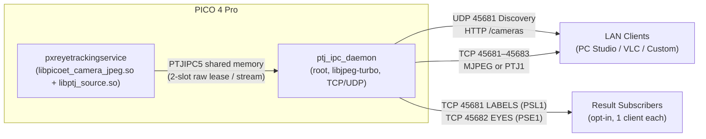

# PicoET-Enhance LAN Camera & Result Protocol

**English** | [简体中文](CAMERA-PROTOCOL_zh.md)

Developer specification for the headset's optional LAN camera streaming service and numerical expression result side channels.

Enable **LAN broadcast** in the headset **PicoET-Enhance** companion app to start the service on demand (defaults off, remembers your choice). For Windows setup and ready-made preview/relay tooling, see [PC Studio](README.md#pc-studio); for standalone developer diagnostics, see `camera-source/device.py`.

> [!WARNING]
> Discovery, camera video, and numerical result feeds are **unencrypted and unauthenticated**. Use only on a trusted private LAN.

## Overview



Because SELinux denies `tcp_socket { setopt bind }` inside `pxreyetrackingservice`, the in-process adapter performs only a synchronous frame copy for actively subscribed lanes. All JPEG encoding, socket I/O, and on-demand native tracking lease management run in the separate root `ptj_ipc_daemon` process.

### Streams & Default Ports

| Stream ID | Camera5 Lane | Default TCP Port | HTTP MJPEG Path | Optional Result Side Channel |
| --- | ---: | ---: | --- | --- |
| `mouth` | `2` | `45681` | `/stream.mjpg` | `LABELS\n` → `PSL1` (640 B) |
| `eye_left` | `0` | `45682` | `/stream.mjpg` | `EYES\n` → `PSE1` (320 B, both eyes) |
| `eye_right` | `1` | `45683` | `/stream.mjpg` | — |

- Every image stream emits **400×400 grayscale (`gray8`) JPEG at quality 95** in the sensor's native orientation.
- Always follow the ports advertised in the catalog: starting `ptj_ipc_daemon` with a custom base port shifts all three ports together (`base`, `base+1`, `base+2`).

## Discovery & Control Endpoints

Discovery, HTTP catalog queries, `CONTEXT`, and `PING` **never subscribe to a stream and never start native tracking**.

### UDP Discovery

Send the exact ASCII datagram `PICO_CAMERA_DISCOVER_V1\n` to **UDP 45681** via broadcast (`255.255.255.255`), multicast (`239.255.255.250`, TTL `1`), or unicast to a known headset IP. When attached to a verified tracking service instance, the daemon replies via unicast with a JSON catalog:

```json
{
  "service": "pico-camera",
  "version": 1,
  "session_id": "123456789",
  "service_generation": "987654",
  "timestamp_semantics": "camera5_parent_sensor_ns",
  "independent_eye_exposures": false,
  "protocols": ["ptj1", "http-mjpeg"],
  "max_clients_per_stream": 8,
  "streams": [
    {"id": "mouth",     "source_lane": 2, "port": 45681, "path": "/stream.mjpg", "width": 400, "height": 400, "pixel_format": "gray8", "encoding": "jpeg", "quality": 95},
    {"id": "eye_left",  "source_lane": 0, "port": 45682, "path": "/stream.mjpg", "width": 400, "height": 400, "pixel_format": "gray8", "encoding": "jpeg", "quality": 95},
    {"id": "eye_right", "source_lane": 1, "port": 45683, "path": "/stream.mjpg", "width": 400, "height": 400, "pixel_format": "gray8", "encoding": "jpeg", "quality": 95}
  ]
}
```

- Combine the UDP reply's source IP with each stream's `port` and `path`.
- `session_id` and `service_generation` are encoded as decimal strings to preserve full 64-bit precision in JSON/JavaScript.
- An unattached daemon stays silent on UDP discovery.
- Legacy mouth-only discovery (`PICO_MOUTH_DISCOVER_V1\n` on UDP 45681) remains supported and replies with the 24-byte `PTC1` struct described below.

### HTTP Catalog

`GET /cameras` and `GET /` on any of the three TCP ports return the same JSON catalog (`200 OK`, `Cache-Control: no-store`, `Connection: close`). When the daemon is not attached to a verified service instance, it returns `503 Service Unavailable`. Unrecognized paths return `404 Not Found`.

The bundled Python discovery helper probes every local IPv4 interface (so it works even when the PC's default route points to a VPN) and cross-checks both HTTP `/cameras` and TCP `CONTEXT` (PC Studio's native Rust implementation lives in `pc-studio/src-tauri/src/discovery.rs`):

```powershell
python camera-source/checks/protocol_client.py --cameras
python camera-source/checks/protocol_client.py --cameras --host <headset-ip>
```

### TCP Control Commands (`CONTEXT` & `PING`)

Open a fresh TCP connection to any of the three stream ports and send one newline-terminated command:

- **`CONTEXT\n`** — Returns the 24-byte little-endian `PTC1` record (`<4sHHQQ>`, `camera-source/capture_context.h`) and closes:

  | Offset | Type | Field | Notes |
  | ---: | --- | --- | --- |
  | `0` | `char[4]` | `magic` | `"PTC1"` |
  | `4` | `uint16` | `version` | `1` |
  | `6` | `uint16` | `bytes` | `24` |
  | `8` | `uint64` | `capture_session_id` | Current daemon capture session |
  | `16` | `uint64` | `service_generation` | Root-verified tracking service instance birth token |

  If the daemon is not attached to a verified service owner, it closes immediately with 0 bytes (EOF). Always bind a fresh `CONTEXT` before collecting metadata or after a service/session restart.

- **`PING\n`** — Returns 16 bytes (`<QQ>`): two little-endian `uint64` headset monotonic nanosecond timestamps (`command_received_ns`, `response_prepared_ns`), then closes.

## Image Subscriptions

### Transport & Connection Semantics

All streaming connections (`GET /stream.mjpg`, `JPEG`, `PAIR`, `LABELS`, `EYES`) share these rules:

- **Receive-only after handshake**: Sending any unexpected bytes after the initial command/HTTP request causes immediate disconnect.
- **Concurrency**: Up to **8** image subscribers may share each stream (mixing HTTP MJPEG and binary `PTJ1`). Each frame is JPEG-encoded once and fanned out; every subscriber has its own writer thread and 1-frame pending slot, so slow clients skip frames without stalling peers.
- **Deadlines & keepalive**: There is no application-level idle heartbeat. The managed daemon enforces a **1,200 ms** per-frame write deadline plus Linux TCP keepalive (`10 s` idle, `3 s × 3` probes) and `TCP_USER_TIMEOUT = 15 s`.
- **On-demand tracking lease**: On Android, the first active image or result subscription acquires one native tracking lease for the daemon; the last unsubscribe releases it. No ADB or separate tracking app is required, though normal headset camera/IR availability still applies.
- **Unsubscribe**: Close the TCP socket.

### HTTP MJPEG (`/stream.mjpg`)

Open any advertised URL in VLC, FFmpeg, a browser ``, or a custom HTTP client:

```text
http://<headset-ip>:45681/stream.mjpg
http://<headset-ip>:45682/stream.mjpg
http://<headset-ip>:45683/stream.mjpg
```

Response headers: `HTTP/1.1 200 OK`, `Content-Type: multipart/x-mixed-replace; boundary=pico-camera`, `Cache-Control: no-store`, `Connection: close`. Exceeding the 8-client limit (or colliding with an active `PAIR` session) returns `503 Service Unavailable`.

Each multipart chunk starts with `--pico-camera\r\n` and carries decimal integer metadata headers before the JPEG payload and trailing `\r\n`:

- `Content-Type: image/jpeg`
- `Content-Length`
- `X-Session-ID`
- `X-Source-Sequence`
- `X-Sensor-Nanoseconds`

Example — save one mouth frame using only Python's standard library:

```python
from urllib.request import urlopen

with urlopen("http://<headset-ip>:45681/stream.mjpg", timeout=10) as stream:
    assert stream.readline().strip() == b"--pico-camera"
    headers = {}
    while (line := stream.readline()) != b"\r\n":
        key, value = line.decode("ascii").strip().split(": ", 1)
        headers[key.lower()] = value
    jpeg = stream.read(int(headers["content-length"]))
    with open("mouth.jpg", "wb") as output:
        output.write(jpeg)
```

### Binary `PTJ1` Stream (`JPEG\n` & `PAIR\n`)

Open a fresh TCP connection to the target stream's port and send `JPEG\n` (no HTTP envelope). The server streams framed packets consisting of a **128-byte little-endian header** (`<4sHHII12Q4I`, `camera-source/core/ptj_source.h`) followed by `payload_bytes` payload bytes:

| Offset | Type | Fields (in order) |
| ---: | --- | --- |
| `0` | `char[4]` | `magic` (`"PTJ1"`) |
| `4` | `2 × uint16` | `version` (`1`), `header_bytes` (`128`) |
| `8` | `2 × uint32` | `payload_bytes`, `flags` |
| `16` | `4 × uint64` | `session_id`, `source_seq`, `sensor_ns`, `vendor_ns` |
| `48` | `4 × uint64` | `copy_mono_ns`, `encode_begin_ns`, `encode_end_ns`, `emit_mono_ns` |
| `80` | `4 × uint64` | `eye0_sensor_ns`, `eye1_sensor_ns`, `mouth_sensor_ns`, `raw_identity` |
| `112` | `4 × uint32` | `width` (`400`), `height` (`400`), `raw_crc32` (IEEE CRC32 of raw pixels), `quality` (`95`) |

**Flags bitmask**:

| Bit | Value | Constant | Meaning |
| ---: | ---: | --- | --- |
| `0` | `1` | `PTJ_JPEG` | Payload is grayscale JPEG (`payload_bytes`) |
| `1` | `2` | `PTJ_RAW` | Payload is raw `400×400` gray8 pixels (`160,000` bytes; `PAIR` mode only) |
| `2` | `4` | `PTJ_END` | Best-effort terminal header (`payload_bytes = 0`) sent on clean shutdown; never appended after a partial write |
| `3` | `8` | `PTJ_REPLAY` | Marks developer replay fixture input |

**`PAIR\n` (exclusive diagnostic mode)**:
- Sending `PAIR\n` instead of `JPEG\n` emits two packets per source frame: raw pixels (`PTJ_RAW`, with `encode_begin_ns = encode_end_ns = 0`) followed by compressed JPEG (`PTJ_JPEG`).
- `PAIR` holds the raw-slot lease through transmission and **cannot coexist** with `JPEG` or MJPEG subscribers on the same stream.

**Ordering & timestamp semantics**:
- All three camera lanes inherit **one camera5 parent sensor timestamp** (`independent_eye_exposures: false`); `eye0_sensor_ns`, `eye1_sensor_ns`, and `mouth_sensor_ns` are not separate eye exposure measurements. `vendor_ns` is carried separately.
- `copy_mono_ns`, `encode_begin_ns`, `encode_end_ns`, and `emit_mono_ns` use the headset's `CLOCK_MONOTONIC`; align them to PC time via `PING` before cross-host comparison.
- A client joining mid-encode starts at a subsequent frame rather than receiving an in-flight frame.
- Reopening the native camera can reset `source_seq` back to `1`, while `sensor_ns` remains monotonic across native starts. Reset your per-connection sequence cursor on reconnect and key recorded frames by `(session_id, source_seq, sensor_ns, vendor_ns, raw_identity)`.

## Numerical Result Side Channels

Both result side channels are **opt-in** under **LAN broadcast → Result sharing** in the companion app and remember their toggle state across restarts.

- Each side channel allows at most **1** concurrent subscriber. Duplicate or refused connections close immediately with EOF.
- Disabling a result toggle closes the active result subscriber with EOF (no `END` frame) without interrupting camera image feeds or PicoFacialBridge.
- PC Studio's camera preview and Cymple eye relay subscribe only to image streams and never open `LABELS` or `EYES`.
- Reference Python decoders live in `camera-source/checks/protocol_client.py` (`read_capture_context`, `read_stock`, and `read_eye`); PC Studio's native Rust protocol implementations live in `pc-studio/src-tauri/src/wire.rs`, `pc-studio/src-tauri/src/stock.rs`, and `pc-studio/src-tauri/src/discovery.rs`.

### Mouth Results (`PSL1` via `LABELS\n`)

Enable **Mouth** under **Result sharing**, then send `LABELS\n` on a fresh TCP connection to the **`mouth` port** (default `45681`).

`PSL1` records are produced by the enhancement hook, so **PicoET-Enhance must be active in enhanced mode (`dual/on`)**, not stock `off` (if the hook attaches after camera startup, the camera adapter binds the sink automatically on its control loop).

Each little-endian **640-byte** record has Python struct format `<4sHHII9QiI134f2I` (`camera-source/stock_record.h`):

| Offset | Type | Fields (in order) |
| ---: | --- | --- |
| `0` | `char[4]` | `magic` (`"PSL1"`) |
| `4` | `2 × uint16` | `version` (`1`), `header_bytes` (`96`) |
| `8` | `2 × uint32` | `record_bytes` (`640`), `flags` (bit 0 `VALID = 1`, bit 1 `ASSOCIATED = 2`, bit 2 `WARMUP = 4`) |
| `16` | `9 × uint64` | `capture_session_id`, `service_generation`, `source_seq`, `mouth_sensor_ns`, `stock_input_ns`, `vendor_ns`, `raw_identity`, `produced_mono_ns`, `label_seq` |
| `88` | `int32`, `uint32` | `classification`, `stages` (`15`) |
| `96` | `33 × float32` | `raw33` — raw mouth model output |
| `228` | `33 × float32` | `instant33` — action-postprocessed, clamped, before temporal filtering |
| `360` | `33 × float32` | `final33` — final temporally filtered output |
| `492` | `2 × float32` | `quality2` — two mouth quality scores |
| `500` | `33 × float32` | `instant_preclamp33` — action-postprocessed before `[0, 1]` clamping |
| `632` | `2 × uint32` | `reserved[2]` (always `0` on wire) |

**Image pairing contract**: `PSL1` records and `PTJ1` images arrive on independent TCP connections. Pair **only** records with `ASSOCIATED` (`flags & 2`) set, matching strictly on `(capture_session_id, service_generation, source_seq, mouth_sensor_ns, vendor_ns, raw_identity)`. Leave missing records or images unmatched — never pair by arrival order or nearest timestamp.

### Eye Expression Results (`PSE1`)

Enable **Both eyes** under **Result sharing**, then send `EYES\n` on a fresh TCP connection to the **`eye_left` port** (default `45682`). One connection carries both eyes.

Each little-endian **320-byte** record has Python struct format `<4sHHII6Q64f` (`camera-source/stock_record.h`):

| Offset | Type | Fields (in order) |
| ---: | --- | --- |
| `0` | `char[4]` | `magic` (`"PSE1"`) |
| `4` | `2 × uint16` | `version` (`1`), `header_bytes` (`64`) |
| `8` | `2 × uint32` | `record_bytes` (`320`), `flags` (bit 0 left updated, bit 1 right updated, bit 2 left valid, bit 3 right valid) |
| `16` | `6 × uint64` | `capture_session_id`, `service_generation`, `sequence`, `left_source_ns`, `right_source_ns`, `produced_mono_ns` |
| `64` | `24 × float32` | `raw24` — 20 raw expression channels + 4 original quality values |
| `160` | `20 × float32` | `post20` — action-postprocessed expressions before clamping |
| `240` | `20 × float32` | `final20` — final temporally filtered expressions |

- Each 20-element expression vector is ordered **left eye (indices `0..9`), then right eye (indices `10..19`)**:
  `BrowDown`, `BrowInnerUp`, `BrowOuterUp`, `Blink`, `LookDown`, `LookIn`, `LookOut`, `LookUp`, `Squint`, `Wide`.
- When a side is not updated in a given record, its `*_source_ns` is `0` — ignore that side's values.
- `PSE1` carries expression vectors only (no gaze ray or pupil position). `left_source_ns` and `right_source_ns` are inference-input timestamps and do not assert a 1:1 match to individual camera images or independent exposure times.

## Source Lifecycle & IPC (`PTJIPC5`)

- **Shared-memory channel**: `ptj_ipc_daemon` creates a private `0700` stage directory under `/data/local/tmp/picoet-camera/` containing `video-channel.bin` (`PTJIPC5`). Each of the three image streams has its own 2-slot raw frame lease; mouth (`PSL1`) and eye (`PSE1`) results each have a 16-slot ring buffer.
- **Process isolation**: The vendor camera callback performs only the lock-free protection copy into a free slot when a stream is subscribed; JPEG encoding and all network writes happen exclusively inside `ptj_ipc_daemon`.
- **Clean shutdown**: Turning **Enable broadcast** off closes all client subscriptions, joins encoder/writer threads, releases the daemon's native tracking lease, verifies raw-slot return acknowledgements, and marks the channel stopped. Closing the companion app leaves sharing active.
- **Version coupling**: Update the main hook (`libpicoet_hook.so`), camera adapter (`libpicoet_camera_jpeg.so`), shim (`libptj_source.so`), controller (`picoet-camera`), and daemon (`ptj_ipc_daemon`) together whenever `PTJIPC5` changes.
- **Developer diagnostics**: `camera-source/device.py` manages its own standalone session; do not use `device.py` state to control the module-managed broadcast service.
