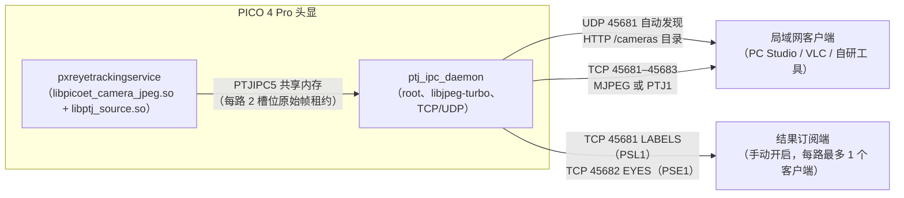

# PicoET-Enhance 局域网相机与结果协议

[English](CAMERA-PROTOCOL.md) | **简体中文**

本规范面向开发者，说明头显端可选的局域网相机推流服务及数值追踪结果侧通道。

在头显 **PicoET-Enhance** 配套应用中开启 **局域网广播** 即可按需启动服务（默认关闭，并记住选择）。Windows 端开箱即用的预览与转发工具见 [PC Studio](README_zh.md#pc-studio)；独立开发诊断脚本见 `camera-source/device.py`。

> [!WARNING]
> 局域网发现、相机视频流和数值结果流均为**明文传输且无身份认证**，请仅在可信的私人局域网中使用。

## 架构概览



由于 SELinux 禁止在 `pxreyetrackingservice` 进程内执行 `tcp_socket { setopt bind }`，进程内适配器仅对存在活跃订阅者的通道做一次同步保护拷贝；所有 JPEG 编码、网络 Socket I/O 以及按需原生追踪租约管理均在独立的 root 进程 `ptj_ipc_daemon` 中完成。

### 通道与默认端口

| 流 ID | Camera5 通道 | 默认 TCP 端口 | HTTP MJPEG 路径 | 可选数值结果侧通道 |
| --- | ---: | ---: | --- | --- |
| `mouth` | `2` | `45681` | `/stream.mjpg` | `LABELS\n` → `PSL1`（640 B） |
| `eye_left` | `0` | `45682` | `/stream.mjpg` | `EYES\n` → `PSE1`（320 B，含双眼） |
| `eye_right` | `1` | `45683` | `/stream.mjpg` | — |

- 三路图像均输出 **400×400 灰度（`gray8`）JPEG（质量 95）**，保持传感器原始朝向。
- 客户端应始终以目录宣告的端口为准：为 `ptj_ipc_daemon` 指定自定义基准端口时，三路端口会整体平移（`base`、`base+1`、`base+2`）。

## 自动发现与控制接口

自动发现、HTTP 目录查询、`CONTEXT` 与 `PING` **均不建立订阅，也不会拉起原生追踪**。

### UDP 自动发现

向 **UDP 45681** 发送精确的 ASCII 数据报 `PICO_CAMERA_DISCOVER_V1\n`，目标可为广播（`255.255.255.255`）、组播（`239.255.255.250`，TTL `1`）或已知头显 IP 单播。守护进程已附加到经过校验的眼动服务实例时，会向发送方单播回复 JSON 目录：

```json
{
  "service": "pico-camera",
  "version": 1,
  "session_id": "123456789",
  "service_generation": "987654",
  "timestamp_semantics": "camera5_parent_sensor_ns",
  "independent_eye_exposures": false,
  "protocols": ["ptj1", "http-mjpeg"],
  "max_clients_per_stream": 8,
  "streams": [
    {"id": "mouth",     "source_lane": 2, "port": 45681, "path": "/stream.mjpg", "width": 400, "height": 400, "pixel_format": "gray8", "encoding": "jpeg", "quality": 95},
    {"id": "eye_left",  "source_lane": 0, "port": 45682, "path": "/stream.mjpg", "width": 400, "height": 400, "pixel_format": "gray8", "encoding": "jpeg", "quality": 95},
    {"id": "eye_right", "source_lane": 1, "port": 45683, "path": "/stream.mjpg", "width": 400, "height": 400, "pixel_format": "gray8", "encoding": "jpeg", "quality": 95}
  ]
}
```

- 将 UDP 回复的源 IP 与每路流的 `port`、`path` 拼接即可访问。
- `session_id` 与 `service_generation` 以十进制字符串编码，避免 JSON / JavaScript 丢失 64 位整数精度。
- 守护进程尚未附加到有效服务实例时，对 UDP 发现保持静默。
- 兼容旧版仅嘴部发现报文 `PICO_MOUTH_DISCOVER_V1\n`（UDP 45681），回复下文所述的 24 字节 `PTC1` 结构。

### HTTP 目录

在任意一路 TCP 端口请求 `GET /cameras` 或 `GET /` 均返回同一份 JSON 目录（`200 OK`、`Cache-Control: no-store`、`Connection: close`）。未附加服务时返回 `503 Service Unavailable`，未知路径返回 `404 Not Found`。

仓库自带的 Python 发现工具会遍历本机所有 IPv4 网卡（即使 PC 默认路由指向 VPN 也能工作），并交叉校验 HTTP `/cameras` 与 TCP `CONTEXT`：

```powershell
python pc-studio/discovery.py --cameras
python pc-studio/discovery.py --cameras --host <头显地址>
```

### TCP 控制命令（`CONTEXT` 与 `PING`）

向任意一路流端口新建 TCP 连接并发送单行命令（以 `\n` 结尾）：

- **`CONTEXT\n`**：返回 24 字节小端序 `PTC1` 记录（`<4sHHQQ>`，见 `camera-source/capture_context.h`）后关闭连接：

  | 偏移 | 类型 | 字段 | 说明 |
  | ---: | --- | --- | --- |
  | `0` | `char[4]` | `magic` | `"PTC1"` |
  | `4` | `uint16` | `version` | `1` |
  | `6` | `uint16` | `bytes` | `24` |
  | `8` | `uint64` | `capture_session_id` | 当前守护进程采集会话 ID |
  | `16` | `uint64` | `service_generation` | root 校验过的眼动服务实例诞生标识 |

  守护进程未附加到有效服务实例时，会直接返回 0 字节（EOF）并关闭。采集元数据前以及服务 / 会话重启后，必须重新执行 `CONTEXT` 握手。

- **`PING\n`**：返回 16 字节（`<QQ>`），依次为两个小端序 `uint64` 头显单调时钟纳秒戳（收到命令时刻 `command_received_ns`、准备回复时刻 `response_prepared_ns`），随后关闭连接。

## 图像流订阅

### 传输与连接约定

所有流式连接（`GET /stream.mjpg`、`JPEG`、`PAIR`、`LABELS`、`EYES`）遵循同一套传输约束：

- **握手后只读**：发送初始命令或 HTTP 请求后，客户端若再发送任何意外字节，服务端会立即断开连接。
- **并发与隔离**：每路图像流最多允许 **8** 个并发订阅者（HTTP MJPEG 与二进制 `PTJ1` 可混用）。每一帧仅执行一次 JPEG 编码并扇出分发；每个订阅者拥有独立写入线程与 1 帧待发缓冲，慢消费者只会跳帧或超时断开，不会阻塞其他消费者。
- **超时与保活**：空闲流上没有应用层心跳。受管守护进程执行 **1,200 ms** 单帧发送截止时间，并开启 Linux TCP Keepalive（空闲 `10 s`，每 `3 s` 探测一次共 `3` 次）与 `TCP_USER_TIMEOUT = 15 s`。
- **按需追踪租约**：在 Android 上，首个活跃图像或结果订阅会为守护进程获取一份原生追踪租约，最后一个订阅断开时自动释放。客户端无需 ADB 或额外追踪应用即可取图，但仍受头显正常的相机 / 红外可用状态约束。
- **取消订阅**：直接关闭 TCP 连接即可。

### HTTP MJPEG（`/stream.mjpg`）

可直接在 VLC、FFmpeg、浏览器 `` 或任意 HTTP 客户端中打开目录宣告的地址：

```text
http://<头显地址>:45681/stream.mjpg
http://<头显地址>:45682/stream.mjpg
http://<头显地址>:45683/stream.mjpg
```

响应头包含 `HTTP/1.1 200 OK`、`Content-Type: multipart/x-mixed-replace; boundary=pico-camera`、`Cache-Control: no-store` 与 `Connection: close`。超过 8 个并发客户端（或与正在进行的 `PAIR` 会话冲突）时返回 `503 Service Unavailable`。

每个分片以 `--pico-camera\r\n` 开头，在 JPEG 载荷与结尾 `\r\n` 之前携带十进制整数元数据头：

- `Content-Type: image/jpeg`
- `Content-Length`
- `X-Session-ID`
- `X-Source-Sequence`
- `X-Sensor-Nanoseconds`

示例 — 仅用 Python 标准库抓取一帧嘴部图像：

```python
from urllib.request import urlopen

with urlopen("http://<头显地址>:45681/stream.mjpg", timeout=10) as stream:
    assert stream.readline().strip() == b"--pico-camera"
    headers = {}
    while (line := stream.readline()) != b"\r\n":
        key, value = line.decode("ascii").strip().split(": ", 1)
        headers[key.lower()] = value
    jpeg = stream.read(int(headers["content-length"]))
    with open("mouth.jpg", "wb") as output:
        output.write(jpeg)
```

### 二进制 `PTJ1` 流（`JPEG\n` 与 `PAIR\n`）

向目标流端口新建 TCP 连接并发送 `JPEG\n`（无 HTTP 封装）。服务端持续发送由 **128 字节小端序帧头**（`<4sHHII12Q4I`，见 `camera-source/core/ptj_source.h`）与紧随其后的 `payload_bytes` 字节载荷组成的封包：

| 偏移 | 类型 | 字段（按顺序） |
| ---: | --- | --- |
| `0` | `char[4]` | `magic`（`"PTJ1"`） |
| `4` | `2 × uint16` | `version`（`1`）、`header_bytes`（`128`） |
| `8` | `2 × uint32` | `payload_bytes`、`flags` |
| `16` | `4 × uint64` | `session_id`、`source_seq`、`sensor_ns`、`vendor_ns` |
| `48` | `4 × uint64` | `copy_mono_ns`、`encode_begin_ns`、`encode_end_ns`、`emit_mono_ns` |
| `80` | `4 × uint64` | `eye0_sensor_ns`、`eye1_sensor_ns`、`mouth_sensor_ns`、`raw_identity` |
| `112` | `4 × uint32` | `width`（`400`）、`height`（`400`）、`raw_crc32`（原始像素 IEEE CRC32）、`quality`（`95`） |

**`flags` 位掩码**：

| 位 | 数值 | 常量 | 含义 |
| ---: | ---: | --- | --- |
| `0` | `1` | `PTJ_JPEG` | 载荷为灰度 JPEG（长度为 `payload_bytes`） |
| `1` | `2` | `PTJ_RAW` | 载荷为原始 `400×400` gray8 像素（`160,000` 字节，仅 `PAIR` 模式） |
| `2` | `4` | `PTJ_END` | 正常停止时尽力发送的终止帧头（`payload_bytes = 0`）；半包写入失败时不会追加 `END` |
| `3` | `8` | `PTJ_REPLAY` | 开发者回放夹具输入标记 |

**`PAIR\n`（独占诊断模式）**：
- 发送 `PAIR\n` 替代 `JPEG\n` 时，每个源帧依次输出原始像素包（`PTJ_RAW`，其中 `encode_begin_ns = encode_end_ns = 0`）与压缩 JPEG 包（`PTJ_JPEG`）。
- `PAIR` 在整帧发送完成前持有受保护的原始槽位租约，因此**不能与同一路流上的 `JPEG` 或 MJPEG 订阅者共存**。

**顺序与时间戳语义**：
- 三路相机共享**同一个 camera5 父传感器时间戳**（`independent_eye_exposures: false`）；`eye0_sensor_ns`、`eye1_sensor_ns` 与 `mouth_sensor_ns` 并非各自独立的曝光测量值，`vendor_ns` 另行保留。
- `copy_mono_ns`、`encode_begin_ns`、`encode_end_ns` 与 `emit_mono_ns` 使用头显 `CLOCK_MONOTONIC`；与 PC 时间比较前请先通过 `PING` 做时钟同步。
- 编码进行中才接入的客户端会从后续新帧开始接收，不会收到半途中的旧帧。
- 原生相机重新打开时可能把 `source_seq` 重置回 `1`，但 `sensor_ns` 在多次原生启停间保持单调递增。客户端重连后应重置排序游标，并用完整五元组 `(session_id, source_seq, sensor_ns, vendor_ns, raw_identity)` 唯一标识已录制帧。

## 数值结果侧通道

两条数值结果侧通道均在配套应用的 **局域网广播 → 结果共享** 中手动开启，并持久化保存开关状态。

- 每条结果通道同时仅支持 **1** 个订阅者；被拒绝或重复的订阅连接会立即以 EOF 关闭。
- 关闭对应结果开关会以 EOF 断开当前结果订阅者（不发送 `END` 帧），不会中断图像流或 PicoFacialBridge。
- PC Studio 的预览与 Cymple 眼部转发仅订阅图像流，从不打开 `LABELS` 或 `EYES`。
- 参考 Python 解码器位于 `pc-studio/stock.py`（`read_stock` 与 `read_eye`）。

### 嘴部结果（`LABELS\n` → `PSL1`）

在 **结果共享** 中开启 **嘴部**，随后向 **`mouth` 端口**（默认 `45681`）新建 TCP 连接并发送 `LABELS\n`。

`PSL1` 记录由增强 hook 产出，因此 **PicoET-Enhance 必须处于增强模式（`dual/on`）** 而非原厂 `off`（若主 hook 晚于相机服务加载，相机适配器会在控制循环中自动绑定回调）。

每条小端序 **640 字节** 记录的 Python struct 格式为 `<4sHHII9QiI134f2I`（见 `camera-source/stock_record.h`）：

| 偏移 | 类型 | 字段（按顺序） |
| ---: | --- | --- |
| `0` | `char[4]` | `magic`（`"PSL1"`） |
| `4` | `2 × uint16` | `version`（`1`）、`header_bytes`（`96`） |
| `8` | `2 × uint32` | `record_bytes`（`640`）、`flags`（bit 0 `VALID = 1`、bit 1 `ASSOCIATED = 2`、bit 2 `WARMUP = 4`） |
| `16` | `9 × uint64` | `capture_session_id`、`service_generation`、`source_seq`、`mouth_sensor_ns`、`stock_input_ns`、`vendor_ns`、`raw_identity`、`produced_mono_ns`、`label_seq` |
| `88` | `int32`、`uint32` | `classification`、`stages`（`15`） |
| `96` | `33 × float32` | `raw33` — 嘴部模型原始输出 |
| `228` | `33 × float32` | `instant33` — 动作后处理并限幅后、时域滤波前的瞬时值 |
| `360` | `33 × float32` | `final33` — 最终时域滤波输出 |
| `492` | `2 × float32` | `quality2` — 两项嘴部质量分数 |
| `500` | `33 × float32` | `instant_preclamp33` — 动作后处理后、`[0, 1]` 限幅前的瞬时值 |
| `632` | `2 × uint32` | `reserved[2]`（线上恒为 `0`） |

**图像配对约束**：`PSL1` 记录与 `PTJ1` 图像经独立 TCP 连接传输。仅配对置位 `ASSOCIATED`（`flags & 2`）的记录，并严格核对 `(capture_session_id, service_generation, source_seq, mouth_sensor_ns, vendor_ns, raw_identity)` 全部一致；缺失记录或图像应保留未配对状态，切勿按到达顺序或最近时间戳凑对。

### 眼部表情结果（`EYES\n` → `PSE1`）

在 **结果共享** 中开启 **双眼**，随后向 **`eye_left` 端口**（默认 `45682`）新建 TCP 连接并发送 `EYES\n`。单条连接同时承载左右双眼数据。

每条小端序 **320 字节** 记录的 Python struct 格式为 `<4sHHII6Q64f`（见 `camera-source/stock_record.h`）：

| 偏移 | 类型 | 字段（按顺序） |
| ---: | --- | --- |
| `0` | `char[4]` | `magic`（`"PSE1"`） |
| `4` | `2 × uint16` | `version`（`1`）、`header_bytes`（`64`） |
| `8` | `2 × uint32` | `record_bytes`（`320`）、`flags`（bit 0 左眼已更新、bit 1 右眼已更新、bit 2 左眼有效、bit 3 右眼有效） |
| `16` | `6 × uint64` | `capture_session_id`、`service_generation`、`sequence`、`left_source_ns`、`right_source_ns`、`produced_mono_ns` |
| `64` | `24 × float32` | `raw24` — 20 项原始表情通道 + 4 项原厂质量值 |
| `160` | `20 × float32` | `post20` — 动作后处理后、限幅前的表情值 |
| `240` | `20 × float32` | `final20` — 最终时域滤波后的表情值 |

- 20 维表情向量按**先左眼（索引 `0..9`）、后右眼（索引 `10..19`）**排列，每侧 10 项依次为：
  `BrowDown`、`BrowInnerUp`、`BrowOuterUp`、`Blink`、`LookDown`、`LookIn`、`LookOut`、`LookUp`、`Squint`、`Wide`。
- 若某侧在本条记录中未更新，对应 `*_source_ns` 为 `0`，应忽略该侧数值。
- `PSE1` 仅包含表情向量，不提供视线射线或瞳孔位置。`left_source_ns` 与 `right_source_ns` 是推理输入时间戳，并不保证与单张相机图像一一对应或代表独立曝光时刻。

## 服务生命周期与共享内存 IPC（`PTJIPC5`）

- **共享内存通道**：`ptj_ipc_daemon` 在 `/data/local/tmp/picoet-camera/` 下建立 `0700` 私有目录并映射 `video-channel.bin`（`PTJIPC5`）。三路图像各自拥有 2 槽位原始帧租约，嘴部（`PSL1`）与眼部（`PSE1`）结果各有 16 槽位环形队列。
- **进程隔离**：原厂相机回调仅在通道被订阅时向空闲槽位做一次无锁保护拷贝；JPEG 编码与所有网络写出完全在 `ptj_ipc_daemon` 内执行。
- **干净关闭**：关闭 **广播总开关** 会终止全部客户端订阅、等待编码与发送线程退出、释放守护进程的原生追踪租约、确认所有原始槽位已归还并标记通道停止。关闭配套应用窗口不影响后台共享。
- **版本配套**：`PTJIPC5` 结构变更时，主 hook（`libpicoet_hook.so`）、相机适配器（`libpicoet_camera_jpeg.so`）、垫片（`libptj_source.so`）、控制器（`picoet-camera`）与守护进程（`ptj_ipc_daemon`）必须同步更新。
- **开发诊断**：`camera-source/device.py` 管理独立的开发会话，请勿用其状态文件控制模块托管的广播服务。
